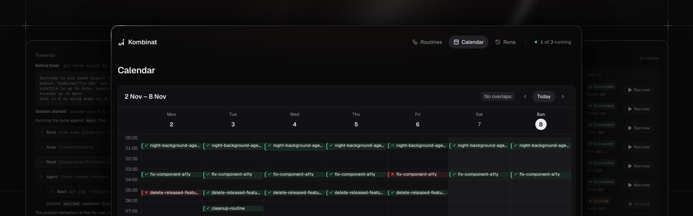

> ✨ Run agents on a schedule or webhook, from markdown files in your repo. On any machine and the plan you already pay for.

One routine is one markdown file, so anyone on the team can write one. Merge it and it is live: a Mac or Linux machine that stays on runs it with Claude Code, Codex or any other CLI agent. Open source (MIT).

[Live demo](https://danilqa.github.io/kombinat/) · [80-second video](https://www.youtube.com/watch?v=P6f0QCEyr68) · [Quickstart](#-quickstart) · [What to run](#-what-to-run)

⭐ Support Kombinat with a [star on GitHub](https://github.com/Danilqa/kombinat) so more people can find it.

## 💡 Features

- **Routines in git.** One markdown file each, live within 5 minutes of the merge.
- **Schedule or webhook.** Cron, or a request from Linear, GitHub or any other app.
- **Any agent.** Claude Code, Codex or any other CLI.
- **Your setup.** Your logins, skills, MCP servers, browser and `CLAUDE.md`.
- **No API bill.** Runs on your subscription and shows how much of the Claude plan is left.
- **Waits out limits.** A run that hits a Claude usage limit continues after the reset.
- **Inbox.** Unread runs, with failures and findings first.
- **Full transcripts.** Search them, and chat to continue any run.
- **Everywhere.** Dashboard in the browser, the terminal or as an app on your phone.
- **Guardrails.** Timeouts, a budget cap, no overlapping runs and catch-up after sleep.
- **Small.** One command, two dependencies, no cloud, no database, no telemetry.

## 🤖 What to run

A routine can be basically any automation, for your team or at home. Teams use them to work through issues overnight, fix bugs and flaky tests, remove dead code, watch production and draft release notes. At home, routines can look for discounts, book appointments, check the weather or tell you when a website changes.

See example routines in the [live demo](https://danilqa.github.io/kombinat/).

## 🚀 Quickstart

1. Create a folder with example routines.

   ```bash
   npx kombinat init my-routines
   ```

   In an existing repo, run `npx kombinat init` in its root, or `pnpm dlx kombinat init` if it uses pnpm. It never overwrites a file.

2. Start it.

   ```bash
   cd my-routines
   npx kombinat serve
   ```

   Open http://localhost:7433. To keep it running in the background and after reboots, stop it and run `npx kombinat install`.

3. Add your own routines to `routines/`, see [Writing a routine](#-writing-a-routine). No restart needed.

## 📊 Monitoring



The daemon serves a dashboard at http://localhost:7433.

- **Routines.**
- **Calendar.**
- **Runs.**
- **Inbox.**
- **Daemon status.**
- **Search.**

### As an app

The dashboard installs as an app with its own window and icon: Install in the address bar of Chrome or Edge, File → Add to Dock in Safari on a Mac, or Share → Add to Home Screen on an iPhone. Install it from http://localhost:7433 or from a [Tailscale Serve](docs/remote-access.md#with-tailscale-serve) address, which stay the same, unlike the local port of `kombinat connect`. In Chrome and Edge, the icon counts the unread runs of the Inbox. When the daemon can't be reached, the app says so and opens the dashboard by itself once it answers.

### In the terminal


`pnpm kombinat tui` shows the same in the terminal. It works over ssh. Press `?` for keys.

## 🌐 Remote access

To open the dashboard from your laptop or phone, connect over SSH with `npx kombinat connect`, or share it in your tailnet with Tailscale Serve. See [docs/remote-access.md](docs/remote-access.md).

## 📚 Example routines

One row per file in [`example/routines/`](example/routines/). Put the same `routines:start` and `routines:end` comments in your own README, and `pnpm kombinat readme` keeps a table like this one up to date.

<!-- prettier-ignore-start -->
<!-- routines:start -->
| Routine | When | What it does |
| - | - | - |
| [weather-example-routine](example/routines/weather-example-routine.md) | Weekdays at 08:00 | Says if you need an umbrella today |
| [hello-example-routine](example/routines/hello-example-routine.md) | Manual | Says hello, to check that your setup works |
| [weather-webhook-example-routine](example/routines/weather-webhook-example-routine.md) | On webhook | Says if you need an umbrella in the city from the request |
<!-- routines:end -->
<!-- prettier-ignore-end -->

## 🧩 How it works

A small daemon starts the agents of due routines, serves the dashboard and keeps the run history. See [docs/how-it-works.md](docs/how-it-works.md).

## 🔒 Security

The dashboard has no login, and agents can do whatever their routine's permissions allow. Read [docs/security.md](docs/security.md) before you open the dashboard to other people or let a routine read issues, chats or webhooks.

## 📦 Setup

You need Node 24 and the agents your routines use, logged in: Claude Code (`claude auth status`) and Codex (`codex login`). From the folder with `routines/` and `package.json`:

```bash
pnpm add kombinat
pnpm kombinat install
```

This starts the daemon in that folder, under launchd on macOS or as a systemd user service on Linux, see [docs/linux.md](docs/linux.md). Open http://localhost:7433. There is one daemon per user, so running `install` in another folder moves it there.

## 💻 Commands

Run them from the same folder. With npm, use `npx kombinat` instead of `pnpm kombinat`, with Yarn `yarn kombinat`.

```bash
pnpm kombinat init [folder]  # add the missing package.json, example routines, README and .gitignore
pnpm kombinat list           # routines, next run, last status
pnpm kombinat run <name>     # run a routine now, in the foreground
pnpm kombinat validate       # check all routine files
pnpm kombinat tui            # dashboard in the terminal, works over ssh
pnpm kombinat status         # daemon and scheduler state
pnpm kombinat readme         # update the routines table in README.md
pnpm kombinat uninstall      # stop and remove the daemon
```

## 📝 Writing a routine

```markdown
---
name: fix-e2e-tests
description: Finds the failing e2e test and fixes it
schedule: '30 11 * * *'
cwd: ~/projects/app
agent: claude
model: claude-opus-5-5
fallbackModel: claude-sonnet-5-5
effort: high
timeoutMinutes: 55
---

1. Open the latest failed e2e run on GitHub ...
```

- `name` must match the file name.
- `schedule` is a 5-field cron in local time, or `manual` to run only on demand.
- `cwd` is where the agent starts.
- `agent` is `claude` (default), `codex` or `command`.
- `timeoutMinutes` stops the run after this time. Default 55.
- `before` is an optional shell command that runs first. If it fails or takes more than 3 minutes, the run fails.
- `after` is an optional shell command that runs last, whatever the outcome, for example to post failures to Slack. It gets the finished run on stdin and cannot change it, see [docs/hooks.md](docs/hooks.md).
- `enabled: false` keeps the file but stops the schedule.
- `webhook: true` lets other apps start the routine with a request, see [docs/webhook.md](docs/webhook.md).

Changes apply on the next check, no restart needed. Write the prompt so the agent never has to ask a question: nobody will answer. When there is nothing to do, have it start its answer with "No" or "Nothing", such as "No open incidents.", so the dashboard's Inbox files the run under Nothing to report.

### Agents

| Setting          | `claude`                                                                          | `codex`                                                        | `command` |
| ---------------- | --------------------------------------------------------------------------------- | -------------------------------------------------------------- | --------- |
| `model`          | default `claude-opus-5-5`                                                         | default from your Codex config                                 | -         |
| `fallbackModel`  | optional, see below                                                               | -                                                              | -         |
| `effort`         | `low`, `medium`, `high` (default), `xhigh`, `max`                                 | `minimal`, `low`, `medium`, `high`, `xhigh`                    | -         |
| `permissionMode` | `auto` (default), `acceptEdits`, `dontAsk`, `bypassPermissions`, `plan`, `manual` | `read-only`, `workspace-write` (default), `danger-full-access` | -         |
| `maxBudgetUsd`   | optional                                                                          | -                                                              | -         |
| `onUsageLimit`   | `wait` (default), `fail`                                                          | -                                                              | -         |
| `command`        | -                                                                                 | -                                                              | required  |

- `claude` runs `claude -p`. Anything that needs approval is denied.
- `fallbackModel` is the model Claude switches to when `model` is not available, overloaded or fails, such as `claude-sonnet-5-5`. A comma-separated list is tried in order. The run's transcript says when it switched.
- `onUsageLimit` says what a run does when it hits the 5-hour or weekly limit of the Claude plan. With `wait`, the run shows Waiting for limit, and a minute after the reset, once a run slot is free, Kombinat continues its session where it stopped. The run's page has Continue now and Stop waiting, and its transcript marks the pause. With `fail`, the run fails at the limit.
- `codex` runs `codex exec`. `permissionMode` sets its sandbox.
- `command` runs any other CLI, for example `command: gemini --yolo`. It gets the prompt on stdin, and its output is the result.

A setting the agent does not support fails validation.

## ⏰ Scheduling

- On macOS, the installed daemon keeps the Mac awake while it is on power. On battery the Mac sleeps as usual, and a laptop with a closed lid can still sleep. macOS has a system-wide switch that turns sleep off, `sudo pmset -a disablesleep 1`, which Kombinat does not touch.
- If the Mac was asleep, each routine runs once for its latest missed time, up to 7 days back.
- A routine never runs twice at the same time. If it is still running at its next time, that run is skipped. A run that waits for a usage limit to reset counts as running.
- At most 3 routines run at once. A run that waits for a usage limit does not count toward this.

## 🪝 Webhooks

A routine with `webhook: true` also runs when another app, such as Linear or GitHub, sends it a request. The request body goes into the prompt, an optional `webhookGate` command checks and filters requests, and requests that arrive while the routine runs wait in a queue. The gate can also tie requests to a conversation, so that follow-ups, such as messages to a Linear agent, continue the run that the first request started. See [docs/webhook.md](docs/webhook.md).

## 🔄 Updating

The daemon runs `git pull` in the folder every 5 minutes, so merged changes go live on their own. It only pulls when the checkout is on `main` with no local changes.

To update Kombinat, bump `kombinat` in `package.json`, for example with a Renovate or Dependabot PR. When the lockfile changes, the daemon installs dependencies with pnpm, npm or Yarn and restarts. Running routines are not interrupted.

When a new version is out, the dashboard shows it in a card in the bottom left corner, with its changelog and the command that updates, and the terminal dashboard says so in its bottom bar. Closing the card skips that version until a newer one comes out.

Up to 0.2.2, Kombinat was published as `@danilqa/kombinat`. To move to `kombinat`, replace the dependency in `package.json`, install it and run `pnpm kombinat install` again. Until then the launchd job of the daemon points into the old package folder, which the install removes, so the daemon does not pick up the new version or start again after a reboot.

## 🔧 Configuration

| Variable                  | Default               | What                                   |
| ------------------------- | --------------------- | -------------------------------------- |
| `KOMBINAT_PORT`           | `7433`                | dashboard port                         |
| `KOMBINAT_STATE_DIR`      | `~/.kombinat`         | logs and history                       |
| `KOMBINAT_ROUTINES_DIR`   | `./routines`          | routine files                          |
| `KOMBINAT_MAX_CONCURRENT` | `3`                   | routines that can run at once          |
| `KOMBINAT_TICK_SECONDS`   | `30`                  | how often the daemon checks routines   |
| `KOMBINAT_PULL_MINUTES`   | `5`                   | auto `git pull` interval, 0 to disable |
| `KOMBINAT_PULL_BRANCH`    | `main`                | branch the daemon pulls                |
| `KOMBINAT_KEEP_AWAKE`     | on when installed     | Mac stays awake on power, 0 to disable |
| `CLAUDE_BIN`              | `~/.local/bin/claude` | Claude Code binary                     |
| `CODEX_BIN`               | `codex`               | Codex binary                           |

Set them before `pnpm kombinat install`. They are saved in the launchd or systemd config.
