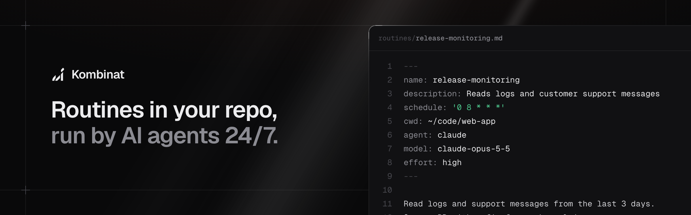
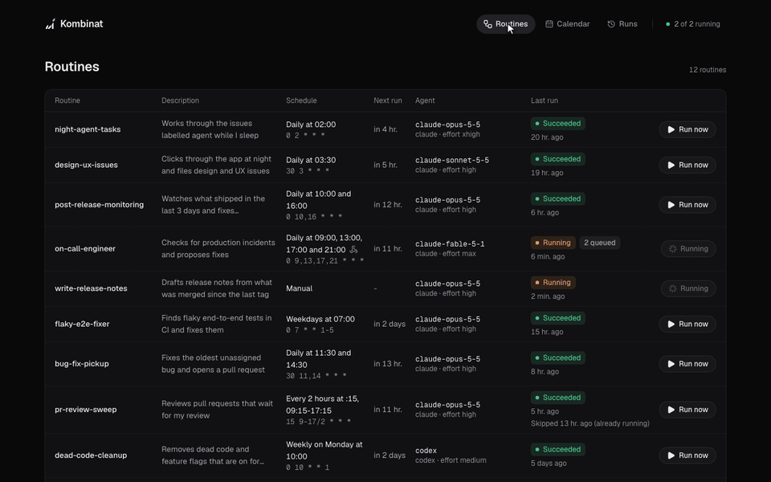
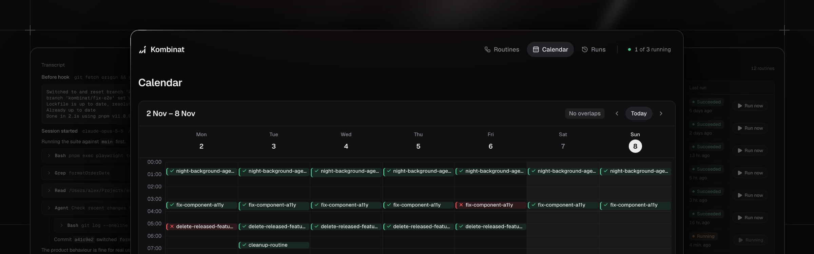
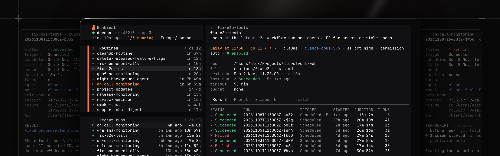

> Run Claude Code and Codex on a schedule.

<a href="https://danilqa.github.io/kombinat/"></a>

[Live demo](https://danilqa.github.io/kombinat/) · [50-second video](https://www.youtube.com/watch?v=18VfIsc5RDE) · [Quickstart](#quickstart) · [What to run](#what-to-run)

## Why

- **A routine is a markdown file.** The frontmatter says when, the body is the prompt.
- **Merging is the deploy.** A routine goes through review like code and is live within five minutes.
- **Your setup, as is.** Agents run with your logins, skills, MCP servers and `CLAUDE.md`.
- **No API bill.** Claude Code and Codex use the subscription you already pay for.
- **Every run on record.** Full transcripts in the browser, in the terminal and on your phone.
- **It stops when it should.** Timeouts, an optional budget cap and no overlapping runs.
- **It starts on events too.** Linear, GitHub or any other app starts a routine with a webhook.
- **Small.** One command, two dependencies, no cloud and no database.

Open source (MIT). It runs on an always-on Mac or Linux machine.

## What to run

Six of the routines in the [live demo](https://danilqa.github.io/kombinat/). Open one to read its full prompt and see sample runs.

| Routine                                                                                | When                                                  | What it does                                                   |
| -------------------------------------------------------------------------------------- | ----------------------------------------------------- | -------------------------------------------------------------- |
| [night-agent-tasks](https://danilqa.github.io/kombinat/routines/night-agent-tasks)     | Daily at 02:00                                        | Works through the issues labelled agent while I sleep          |
| [flaky-e2e-fixer](https://danilqa.github.io/kombinat/routines/flaky-e2e-fixer)         | Weekdays at 07:00                                     | Finds flaky end-to-end tests in CI and fixes them              |
| [on-call-engineer](https://danilqa.github.io/kombinat/routines/on-call-engineer)       | Daily at 09:00, 13:00, 17:00 and 21:00 and on webhook | Checks for production incidents and proposes fixes             |
| [design-ux-issues](https://danilqa.github.io/kombinat/routines/design-ux-issues)       | Daily at 03:30                                        | Clicks through the app at night and files design and UX issues |
| [support-signals](https://danilqa.github.io/kombinat/routines/support-signals)         | Daily at 18:00                                        | Turns the day's support chats into product signals             |
| [write-release-notes](https://danilqa.github.io/kombinat/routines/write-release-notes) | Manual                                                | Drafts release notes from what was merged since the last tag   |

## How it compares

| Instead of                        | Kombinat gives you                                                                                                                        |
| --------------------------------- | ----------------------------------------------------------------------------------------------------------------------------------------- |
| Running Claude Code by hand       | The work happens on schedule, and nobody has to remember it.                                                                              |
| Claude Code's own Routines        | Routines that live in git and go through review, run on your own machine with your local setup, and can use Codex or any other CLI agent. |
| A cron job that calls `claude -p` | Run history, transcripts, timeouts, no overlapping runs, a dashboard and webhooks, without building them.                                 |
| A scheduled CI workflow           | Agents that run where your logins, skills and MCP servers already are, on your subscription login.                                        |

## Quickstart

1. Add Kombinat to the repository that will hold your routines.

   ```bash
   pnpm add kombinat   # with npm: npm install kombinat
   ```

2. Add your routines as `.md` files in a `routines/` folder next to `package.json`, see [Writing a routine](#writing-a-routine). Changes are picked up on the next check, no restart needed. Agents run with your usual setup, so your global skills, MCP servers and `CLAUDE.md` are picked up.

   ```
   my-routines-or-project/
   ├── routines/
   │   └── fix-e2e-tests.md
   └── package.json
   ```

3. Start from that folder.

   ```bash
   pnpm kombinat serve   # or: npx kombinat serve
   ```

   It runs in this terminal. To keep it running in the background and after reboots, stop it and run `pnpm kombinat install` instead, see [Setup](#setup).

4. Monitor and debug runs in the dashboard at http://localhost:7433, or in the terminal with `pnpm kombinat tui`, which also works over ssh. See [Monitoring](#monitoring). To open them from another machine, see [Remote access](#remote-access).

## Monitoring



The daemon serves a dashboard at http://localhost:7433.

- **Routines.**
- **Calendar.**
- **Runs.**
- **Daemon status.**

### In the terminal



`pnpm kombinat tui` shows the same in the terminal. It works over ssh. Press `?` for keys.

## Remote access

### Over SSH

Turn on Remote Login on the Mac that runs Kombinat, in System Settings → General → Sharing. Then, on your laptop:

```bash
npx kombinat connect admin@mac-mini         # dashboard in the browser
npx kombinat connect admin@mac-mini --tui   # dashboard in the terminal
```

It opens an SSH tunnel to the daemon, then the dashboard. SSH asks for the password if you have no key set up. Ctrl-C disconnects. Instead of `admin@mac-mini`, use anything `ssh` accepts: a host from `~/.ssh/config`, an IP address or a Tailscale machine name. If the daemon there uses another `KOMBINAT_PORT`, add `--port`.

You can also ssh in and run `pnpm kombinat tui` in the folder Kombinat runs in.

### With Tailscale Serve

To open the dashboard from any device in your tailnet, your phone included, run this on the Mac that runs Kombinat:

```bash
tailscale serve --bg 7433
```

The dashboard is then at `https://mac-mini.<your-tailnet>.ts.net`, and `npx kombinat tui --url https://mac-mini.<your-tailnet>.ts.net` shows it in the terminal. Serve needs HTTPS certificates in your tailnet, the command asks to turn them on. They put the machine name in public certificate logs. It stays on after a reboot, `tailscale serve --https=443 off` turns it off. If the Mac has no `tailscale` command, see [Using the Tailscale CLI](https://tailscale.com/kb/1080/cli).

Everyone who can reach the Mac in your tailnet can then read transcripts and start routines. To limit that, allow only some people to reach port 443 of the Mac in your [Tailscale access rules](https://tailscale.com/kb/1018/acls).

## Routines

The example routines of this repository, one row per file in [`routines/`](routines/). Put the same `routines:start` and `routines:end` comments in your own README, and `pnpm kombinat readme` keeps a table like this one up to date.

<!-- prettier-ignore-start -->
<!-- routines:start -->
| Routine | When | What it does |
| - | - | - |
| [weather-example-routine](routines/weather-example-routine.md) | Weekdays at 08:00 | Says if you need an umbrella today |
| [weather-webhook-example-routine](routines/weather-webhook-example-routine.md) | On webhook | Says if you need an umbrella in the city from the request |
<!-- routines:end -->
<!-- prettier-ignore-end -->

## How it works

- Each routine is a markdown file. The frontmatter sets the schedule and settings, the body is the prompt.
- A small daemon checks every 30 seconds which routines are due and starts their agent. It also serves a dashboard at http://localhost:7433.
- launchd on macOS or systemd on Linux keeps the daemon running and starts it again after a reboot. Runs only happen while the computer is awake and you are logged in. On Linux, [lingering](docs/linux.md#lingering) lets them run while you are logged out.
- Logs and run history are stored in `~/.kombinat/`.
- Claude and Codex use your subscription login. API key variables are removed from their environment.

## Limits and security

- It runs on macOS under launchd or on Linux under systemd, see [docs/linux.md](docs/linux.md). Runs happen only while the machine is awake. On macOS you must be logged in; on Linux, lingering lets them run while you are logged out.
- The dashboard listens on localhost only and has no login. To open it from another machine, use SSH or Tailscale Serve and limit who can reach it, see [Remote access](#remote-access).
- Each routine sets its own permission mode, see [Agents](#agents). By default Claude Code is denied anything that needs approval, and Codex writes only in its workspace. `bypassPermissions` and `danger-full-access` let the agent do anything your user can.
- A routine that reads outside text, such as issues, support chats or a webhook body, can be steered by that text. Give it the narrowest permissions, let it open pull requests but not merge them, and check webhook requests with a [`webhookGate`](docs/webhook.md#gate).
- A run stops after 55 minutes by default. Claude Code can also have a budget cap. At most 3 routines run at once, and a routine never runs twice at the same time.
- The daemon runs `git pull` every 5 minutes and installs dependencies when the lockfile changes, so protect `main` with review.
- No telemetry. The daemon makes no network calls of its own: it only starts git, your package manager and the agents.
- Claude Code and Codex run on your subscription login. Check the terms of your plan before a team shares one login.

## Setup

You need Node 24 and the agents your routines use, logged in: Claude Code (`claude auth status`) and Codex (`codex login`). From the folder with `routines/` and `package.json`:

```bash
pnpm add kombinat
pnpm kombinat install
```

This starts the daemon in that folder, under launchd on macOS or as a systemd user service on Linux, see [docs/linux.md](docs/linux.md). Open http://localhost:7433. There is one daemon per user, so running `install` in another folder moves it there.

## Commands

Run them from the same folder. With npm, use `npx kombinat` instead of `pnpm kombinat`, with Yarn `yarn kombinat`.

```bash
pnpm kombinat list           # routines, next run, last status
pnpm kombinat run <name>     # run a routine now, in the foreground
pnpm kombinat validate       # check all routine files
pnpm kombinat tui            # dashboard in the terminal, works over ssh
pnpm kombinat status         # daemon and scheduler state
pnpm kombinat readme         # update the routines table in README.md
pnpm kombinat uninstall      # stop and remove the daemon
```

## Writing a routine

```markdown
---
name: fix-e2e-tests
description: Finds the failing e2e test and fixes it
schedule: '30 11 * * *'
cwd: ~/projects/app
agent: claude
model: claude-opus-5-5
fallbackModel: claude-sonnet-5-5
effort: high
timeoutMinutes: 55
---

1. Open the latest failed e2e run on GitHub ...
```

- `name` must match the file name.
- `schedule` is a 5-field cron in local time, or `manual` to run only on demand.
- `cwd` is where the agent starts.
- `agent` is `claude` (default), `codex` or `command`.
- `timeoutMinutes` stops the run after this time. Default 55.
- `before` is an optional shell command that runs first. If it fails or takes more than 3 minutes, the run fails.
- `after` is an optional shell command that runs last, whatever the outcome, for example to post failures to Slack. It gets the finished run on stdin and cannot change it, see [docs/hooks.md](docs/hooks.md).
- `enabled: false` keeps the file but stops the schedule.
- `webhook: true` lets other apps start the routine with a request, see [docs/webhook.md](docs/webhook.md).

Changes apply on the next check, no restart needed. Write the prompt so the agent never has to ask a question: nobody will answer.

### Agents

| Setting          | `claude`                                                                          | `codex`                                                        | `command` |
| ---------------- | --------------------------------------------------------------------------------- | -------------------------------------------------------------- | --------- |
| `model`          | default `claude-opus-5-5`                                                         | default from your Codex config                                 | -         |
| `fallbackModel`  | optional, see below                                                               | -                                                              | -         |
| `effort`         | `low`, `medium`, `high` (default), `xhigh`, `max`                                 | `minimal`, `low`, `medium`, `high`, `xhigh`                    | -         |
| `permissionMode` | `auto` (default), `acceptEdits`, `dontAsk`, `bypassPermissions`, `plan`, `manual` | `read-only`, `workspace-write` (default), `danger-full-access` | -         |
| `maxBudgetUsd`   | optional                                                                          | -                                                              | -         |
| `command`        | -                                                                                 | -                                                              | required  |

- `claude` runs `claude -p`. Anything that needs approval is denied.
- `fallbackModel` is the model Claude switches to when `model` is not available, overloaded or fails, such as `claude-sonnet-5-5`. A comma-separated list is tried in order. The run's transcript says when it switched.
- `codex` runs `codex exec`. `permissionMode` sets its sandbox.
- `command` runs any other CLI, for example `command: gemini --yolo`. It gets the prompt on stdin, and its output is the result.

A setting the agent does not support fails validation.

## Scheduling

- On macOS, the installed daemon keeps the Mac awake while it is on power. On battery the Mac sleeps as usual, and a laptop with a closed lid can still sleep. macOS has a system-wide switch that turns sleep off, `sudo pmset -a disablesleep 1`, which Kombinat does not touch.
- If the Mac was asleep, each routine runs once for its latest missed time, up to 7 days back.
- A routine never runs twice at the same time. If it is still running at its next time, that run is skipped.
- At most 3 routines run at once.

## Webhooks

A routine with `webhook: true` also runs when another app, such as Linear or GitHub, sends it a request. The request body goes into the prompt, an optional `webhookGate` command checks and filters requests, and requests that arrive while the routine runs wait in a queue. See [docs/webhook.md](docs/webhook.md).

## Updating

The daemon runs `git pull` in the folder every 5 minutes, so merged changes go live on their own. It only pulls when the checkout is on `main` with no local changes.

To update Kombinat, bump `kombinat` in `package.json`, for example with a Renovate or Dependabot PR. When the lockfile changes, the daemon installs dependencies with pnpm, npm or Yarn and restarts. Running routines are not interrupted.

Up to 0.2.2, Kombinat was published as `@danilqa/kombinat`. To move to `kombinat`, replace the dependency in `package.json`, install it and run `pnpm kombinat install` again. Until then the launchd job of the daemon points into the old package folder, which the install removes, so the daemon does not pick up the new version or start again after a reboot.

## Configuration

| Variable                  | Default               | What                                   |
| ------------------------- | --------------------- | -------------------------------------- |
| `KOMBINAT_PORT`           | `7433`                | dashboard port                         |
| `KOMBINAT_STATE_DIR`      | `~/.kombinat`         | logs and history                       |
| `KOMBINAT_ROUTINES_DIR`   | `./routines`          | routine files                          |
| `KOMBINAT_MAX_CONCURRENT` | `3`                   | routines that can run at once          |
| `KOMBINAT_TICK_SECONDS`   | `30`                  | how often the daemon checks routines   |
| `KOMBINAT_PULL_MINUTES`   | `5`                   | auto `git pull` interval, 0 to disable |
| `KOMBINAT_PULL_BRANCH`    | `main`                | branch the daemon pulls                |
| `KOMBINAT_KEEP_AWAKE`     | on when installed     | Mac stays awake on power, 0 to disable |
| `CLAUDE_BIN`              | `~/.local/bin/claude` | Claude Code binary                     |
| `CODEX_BIN`               | `codex`               | Codex binary                           |

Set them before `pnpm kombinat install`. They are saved in the launchd or systemd config.
